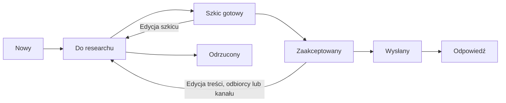

# KAIROX Reach Out — specyfikacja lokalnego MVP

Status: zaimplementowane lokalne MVP, 2026-10-02. Dokument ustala architekturę, dane i zachowanie.

## 1. Cel i granice

Jedna osoba porządkuje firmy, zapisuje research, kwalifikuje kontakty i przygotowuje szkice pierwszej wiadomości. Użytkownik sam zatwierdza treść, wysyła ją poza aplikacją i ręcznie zapisuje wynik kontaktu.

MVP obsługuje jedną lokalną bazę w jednej przeglądarce. Jeden lead oznacza jedną firmę, jedną osobę kontaktową i jeden szkic pierwszej wiadomości. Nazwa osoby może pozostać pusta, jeżeli kontakt odbywa się przez ogólny adres firmy lub formularz.

W zakresie: ręczne dodawanie i edycja firm, dodawanie pojedynczego leada z jednego pola JSON przygotowanego przez zewnętrzne AI, research i źródła, checklista kwalifikacji, szkic, akceptacja, nieedytowalna historia kontaktu, rejestr wysłania i odpowiedzi, notatki oraz terminy follow-upów, kopia danych JSON oraz lokalny serwer plikowej bazy.

Poza zakresem: logowanie, chmura, synchronizacja między instancjami, automatyczna wysyłka, odczyt skrzynki, scraping, generowanie AI wewnątrz aplikacji, bezpośrednia integracja z usługą AI, masowe kampanie, załączniki, wiele osób w firmie, sekwencje szkiców, powiadomienia w tle, Kanban i analityka sprzedaży. Follow-up w MVP to termin i ręczna notatka o kontakcie; tworzenie kolejnych zatwierdzanych szkiców wymaga przyszłego rozszerzenia.

## 2. Wybrany stack

| Warstwa | Decyzja | Powód |
| --- | --- | --- |
| Interfejs | HTML, zwykły CSS, JavaScript z modułami ES | Trzy proste widoki nie potrzebują frameworka ani biblioteki komponentów. |
| Uruchamianie i build | Node HTTP, Vite jako middleware dev, npm | Jeden lokalny proces obsługuje UI i API na stałym porcie; Vite nie przechowuje danych biznesowych. |
| Stan aplikacji | Jeden obiekt w pamięci; jawne funkcje zmiany danych | Brak biblioteki zarządzania stanem. |
| Zapis | Jeden dokument JSON w `data/workspace.json` | Mała, tekstowa baza lokalna bez usługi bazodanowej. |
| Kopia danych | Eksport i import pliku JSON | Ręczna kopia i przenoszenie bazy między przeglądarkami. |
| Testy logiki | Wbudowany runner Node (`node --test`) | Testowanie statusów i walidacji bez dodatkowej biblioteki. |

Brak nowych zależności runtime poza Node; Vite służy do middleware dev i buildu. Brak zależności frontendowych uruchamianych w produkcji, zewnętrznych fontów, analityki i CDN.

Stały adres pracy: `http://127.0.0.1:5173`, wyłącznie własny host/origin. `npm run dev` uruchamia `node server/start.js --dev`; `npm run build`, `npm start` i `npm run preview` używają tego samego procesu Node do serwowania builda i API. Nie uruchamiaj dwóch instancji ani nie edytuj pliku podczas pracy. Uruchamianie przez `file://` nie jest wspierane.

## 3. Jedyny zestaw statusów

Identyfikatory są zapisywane w danych, polskie etykiety wyświetlane w interfejsie. Przyszły moduł `statuses.js` będzie jedynym źródłem mapowania w kodzie.

| ID | Etykieta | Znaczenie / następna czynność |
| --- | --- | --- |
| `new` | Nowy | Firma dodana. Rozpocznij research. |
| `research` | Do researchu | Uzupełnij informacje, kwalifikację i szkic. Obejmuje research rozpoczęty oraz szkic roboczy. |
| `draft_ready` | Szkic gotowy | Kompletna wiadomość czeka na ręczne zatwierdzenie. |
| `approved` | Zaakceptowany | Użytkownik zatwierdził dokładnie tę treść dla tego odbiorcy i kanału. |
| `sent` | Wysłany | Użytkownik potwierdził, że sam wysłał wiadomość poza aplikacją. |
| `replied` | Odpowiedź | Użytkownik zarejestrował otrzymaną odpowiedź. |
| `rejected` | Odrzucony | Kontakt zamknięty z zapisanym powodem, np. brak dopasowania lub odmowa. |

`Zakwalifikowany` nie jest statusem: wynika z checklisty. `Do akceptacji` to filtr `draft_ready`. `Follow-up` to data i filtr, niezależny od statusu. Nie dodajemy drugiej listy statusów wiadomości.

Historia kontaktu nie tworzy dodatkowego statusu i nie rozszerza limitu dwóch follow-upów. Zmiana statusu, w tym cofnięcie akceptacji po edycji lub zmianie ICP, dopisuje zdarzenie `status_change`.



Diagram pokazuje główną ścieżkę. Odrzucenie jest możliwe z każdego innego statusu, z obowiązkowym powodem. `rejected` kończy pracę z leadem w MVP; nie przewidujemy przywracania. Historia wysłania i odpowiedzi zostaje zachowana.

### Reguły przejść i akceptacji

- Status zmienia się przez nazwaną akcję, nie przez dowolny wybór z listy.
- `new → research`: „Rozpocznij research”.
- `research → draft_ready`: „Przekaż do akceptacji”. Wymagane: ustawiony ICP, wszystkie cztery kryteria kwalifikacji na `true`, opis potrzeby i powodu kontaktu, co najmniej jedno źródło URL, kanał i właściwy kontakt, niepusta treść; dla e-maila również temat.
- `draft_ready → approved`: „Zatwierdź wiadomość”. Ponownie sprawdź wymagania i ustaw `approvedAt`.
- Edycja treści, tematu, kanału, adresu lub osoby kontaktowej w `draft_ready` albo `approved` cofa do `research` i usuwa `approvedAt`. Zmiana danych researchowych/kwalifikacji leada także wymaga ponownej akceptacji. Sam termin follow-upu i zwykłe notatki nie unieważniają akceptacji.
- Edycja globalnego ICP cofa wszystkie niewysłane `draft_ready`/`approved` do `research`, zeruje ich akceptację i ustawia `qualification.icpFit` na `null` dla wszystkich niewysłanych, nieodrzuconych leadów. Wysłane wiadomości pozostają historycznym zapisem.
- „Kopiuj wiadomość” jest aktywne po akceptacji, również dla wysłanej historii. Kopiowanie i otwieranie zewnętrznego profilu nie zmieniają statusu.
- `approved → sent`: osobne „Potwierdź ręczne wysłanie”, z podsumowaniem odbiorcy i datą/czasem wysłania, domyślnie teraz. Ustaw `sentAt`; nie wykonuj żadnego żądania wysyłającego wiadomość. Czas wysłania nie może być przyszły ani wcześniejszy od akceptacji.
- Po wysłaniu dane odbiorcy, kanału i pierwszego szkicu stają się tylko do odczytu. Notatki, research i terminy można dalej uzupełniać; nie zmieniają historycznej treści.
- `sent → replied`: „Dodaj odpowiedź” może być użyte wielokrotnie; wymaga body lub podsumowania, czasu otrzymania i kanału, opcjonalnie notatki i następnego kroku. Każde użycie dopisuje event, ustawia `repliedAt` na najnowszą datę i czyści aktywny termin follow-upu. Użytkownik może ustawić nowy, o ile nie wykorzystano limitu dwóch follow-upów.
- Odrzucenie usuwa aktywny termin follow-upu; dla niewysłanego szkicu także `approvedAt`. Zachowuje zapis istniejącej wysyłki i odpowiedzi.
- Zmiana statusu i związanych pól to jedna operacja zapisu. UI nie pokazuje sukcesu przed udanym utrwaleniem.

## 4. Model danych

Jeden dokument `Workspace` pod kluczem `kairox-reach-out:v1`. Nie tworzymy osobnych tabel firm, kontaktów i wiadomości.

| Pole | Typ / zasada |
| --- | --- |
| `schemaVersion` | Liczba `1`; format importu, niezależny od wersji aplikacji. |
| `updatedAt` | Znacznik czasu ISO 8601 UTC ostatniego zapisu. |
| `settings.icp` | Obiekt z tekstami `target`, `need`, `exclude`: jaka firma, jaka potrzeba, kogo wykluczamy. |
| `leads` | Tablica rekordów `Lead`. |

| Pole `Lead` | Typ / zasada |
| --- | --- |
| `id` | Niepowtarzalny UUID, generowany lokalnie. |
| `companyName` | Wymagany niepusty tekst. Jedyny obowiązkowy wpis w formularzu dodawania. |
| `website`, `industry`, `city` | Opcjonalne teksty, domyślnie `""`. Strona: URL HTTP/HTTPS. |
| `contact` | `{ name, role, email, linkedinUrl, formUrl }`; opcjonalne teksty. |
| `channel` | `null`, `email`, `linkedin` lub `contact_form`. |
| `status` | Dokładnie jeden z siedmiu identyfikatorów powyżej; początkowo `new`. |
| `research` | `{ summary, need, contactReason, sources }`; teksty i tablica źródeł `{ url, note }`. |
| `qualification` | `{ icpFit, needIdentified, contactSuitable, reasonCredible }`; każde `null` (nieocenione), `true` (tak) lub `false` (nie). |
| `draft` | `{ subject, body }`; zwykły tekst, domyślnie puste ciągi. |
| `approvedAt`, `sentAt`, `repliedAt` | Znaczniki czasu ISO 8601 UTC albo `null`. |
| `contactHistory` | Opcjonalna tablica zdarzeń historii. Przy `schemaVersion: 1` brak pola jest obsługiwany przez czytelną projekcję legacy. |
| `rejectionReason` | Tekst; wymagany wyłącznie w `rejected`. |
| `notes` | Zwykły tekst, domyślnie `""`; ręczne obserwacje i zapis odpowiedzi. |
| `followUp` | `{ dueDate, note }`; `dueDate` to `YYYY-MM-DD` albo `null`, notatka to tekst. |
| `followUpLog` | Tablica `{ completedAt, channel, note }`; ręczny rejestr faktycznie wykonanych kolejnych kontaktów. Kanał z tej samej listy, bez `null`. |
| `createdAt`, `updatedAt` | Znaczniki czasu ISO 8601 UTC. |

Wszystkie wymienione pola poza opcjonalnym `contactHistory` są wymagane w zapisanym rekordzie. Nowy lead ma puste teksty/tablice, `null` dla dat, kanału i kryteriów kwalifikacji oraz aktualne `createdAt`/`updatedAt`.

### Historia kontaktu (`Lead.contactHistory[]`)

Każde zdarzenie ma kształt `{ id, type, occurredAt, recordedAt, channel, direction, status, subject, body, note, nextStep, recipient, fromStatus, source }`. `type` to `first_message`, `follow_up`, `reply`, `note` albo `status_change`; `channel` to `email`, `linkedin`, `contact_form` albo `null`; `direction` to `outbound`, `inbound` albo `internal`; `source` to `recorded` albo `legacy`. Daty są ISO 8601 UTC, `status` jest jednym z siedmiu statusów, `recipient` to `null` albo `{ name, role, email, linkedinUrl, formUrl }`, a pola tekstowe są wyświetlane jako tekst, również jeśli użytkownik wklei znaczniki HTML. `fromStatus` jest `null` albo statusem.

Oś czasu pokazuje najnowsze zdarzenia jako pierwsze i zajmuje jedną sekcję na karcie. Wpisów nie można edytować ani usuwać. Dla notatek i zmian statusu kierunek jest `internal`, a kanał może być `null` (nie dotyczy). Snapshot wysłania zachowuje pełny temat, body, recipient i kanał; późniejsze notatki go nie zmieniają.

Starszy lead bez `contactHistory` otrzymuje odtworzoną projekcję z `sentAt` i draft/contact, `followUpLog`, `repliedAt`, `notes` oraz `rejectionReason`, ze źródłem `legacy`. Brakujące treści odpowiedzi i dokładne daty notatek pozostają nieustalone. Projekcja zapisuje się przy kolejnym zapisie leada, z backupem; `GET` nie nadpisuje bazy.

„Dodaj odpowiedź” działa wielokrotnie dla `sent` i `replied`, wymaga body lub podsumowania, daty otrzymania i kanału, opcjonalnie notatki i następnego kroku. Każde użycie tworzy nowy event `reply` inbound, ustawia `replied`, czyści follow-up i ustawia `repliedAt` na najnowszą datę odpowiedzi. „Dodaj notatkę” jawnie tworzy `note`; istniejące ogólne `notes` pozostaje polem roboczym. Limit dwóch follow-upów i harmonogram 3 dni, następnie 5–7 dni roboczych pozostają bez zmian.

Warunki kontaktu zależą od kanału: `email` wymaga poprawnego adresu e-mail, `linkedin` adresu profilu, `contact_form` adresu formularza. `contactSuitable` może być prawdziwe dla sensownego kontaktu ogólnego firmy — imię osoby nie jest obowiązkowe.

Kwalifikacja to ręczna ocena czterech kryteriów, bez punktacji i automatycznej decyzji. Wszystkie `true` pozwalają przekazać szkic; `false` nie zmienia automatycznie statusu na `rejected`.

Follow-up można ustawić tylko dla `sent` lub `replied`. Potwierdzenie pierwszego wysłania automatycznie ustawia termin po 3 dniach roboczych (poniedziałek–piątek). „Zapisz wykonany follow-up” wymaga notatki, kanału i daty/czasu nie wcześniejszych od pierwszego wysłania oraz nie przyszłych; dopisuje wpis do `followUpLog` i nie uruchamia wysyłki. Po pierwszym wpisie ustawia początek zalecanego okna drugiego kontaktu po 5 dniach roboczych, a jego koniec po 7 dniach roboczych zapisuje w notatce. Po drugim wpisie czyści termin, blokuje trzeci follow-up i oznacza nieodpowiadający lead jako wymagający zamknięcia albo odłożenia.

Daty follow-upów oznaczają lokalny dzień kalendarzowy przeglądarki, bez konwersji przez UTC. Daty/czasy zdarzeń zapisujemy w UTC i pokazujemy lokalnie. Zadanie na dziś ma `dueDate == dzisiaj`, zaległe `< dzisiaj`. Filtr follow-upów obejmuje oba przypadki i tylko `sent`/`replied`.

## 5. Widoki i układ

### A. Lista firm — ekran startowy

Nagłówek „KAIROX Reach Out”, przycisk „Dodaj firmę” i link „Ustawienia”. Poniżej wyszukiwarka firmy/osoby/e-maila, filtr statusu oraz szybkie filtry „Wszystkie”, „Do akceptacji” i „Follow-up”. Szybki filtr zastępuje filtr statusu, zamiast tworzyć sprzeczne kombinacje; wyszukiwarka działa razem z nim.

Tabela: **Firma | Kontakt / kanał | Status | Następny krok | Follow-up**. Wiersz otwiera kartę firmy. Następny krok jest wyliczany ze statusu, terminu i liczby wykonanych follow-upów; po drugim kontakcie bez odpowiedzi pokazuje decyzję „zamknij lub odłóż”. Nie jest drugim ręcznie utrzymywanym polem. Na telefonie wiersze stają się kartami.

Domyślnie sortuj po `updatedAt` malejąco; w filtrze follow-upów po terminie rosnąco. Pusta baza: krótka instrukcja i „Dodaj pierwszą firmę”. Brak wyników filtra nie udaje pustej bazy. Formularz dodawania wymaga tylko nazwy firmy.

### B. Karta firmy — jeden przewijany formularz

```text
← Lista firm                Nazwa firmy        [Status]
Dane firmy i kontakt                 [Zapisz zmiany]
Research: opis, potrzeba, powód, źródła
Kwalifikacja: cztery pytania Tak / Nie / Nieocenione
Wiadomość: kanał, temat, treść
[Akcja odpowiednia do aktualnego statusu]
Notatki i odpowiedź
Follow-up: termin, notatka, historia wykonanych kontaktów
[Odrzuć kontakt]
```

Wystarczy jedna kolumna i wyraźne sekcje, bez osobnych stron researchu i wiadomości. Przed akceptacją pokaż odbiorcę, kanał i pełną treść. Dla LinkedIn/formularza ukryj pole tematu, zachowując treść szkicu. Dla wysłanego szkicu pokaż datę wysłania i treść tylko do odczytu.

Formularz ma jawny zapis i wskaźnik niezapisanych zmian. Akcje workflow najpierw walidują i zapisują bieżący formularz. Próba opuszczenia karty z niezapisanymi zmianami pozwala zapisać, odrzucić zmiany lub zostać. Błędy pojawiają się przy właściwych polach; status ma etykietę tekstową, nie sam kolor.

### C. Ustawienia — ICP i kopia danych

Trzy pola ICP: docelowa firma, potrzeba, wykluczenia. Przy zmianie ICP pokaż liczbę niewysłanych szkiców wymagających ponownej oceny. Niżej „Eksportuj kopię JSON” i „Importuj kopię JSON”. Bez konta, integracji, kluczy API i edytora statusów.

Nie dodajemy osobnego dashboardu, kalendarza ani widoku powiadomień. Nawigacja wystarczy przez hashe `#/leads`, `#/leads/:id`, `#/settings`; nie wymaga biblioteki routera. Nieznane ID pokazuje komunikat i powrót do listy.

## 6. Zapis plikowy, import i ograniczenia lokalnej bazy

- Jeden proces Node nasłuchuje wyłącznie na `127.0.0.1:5173`; udostępnia `GET /api/workspace` i `PUT /api/workspace`, bez CORS. PUT wymaga `Content-Type: application/json`, własnego `Origin` i `If-Match`.
- Brak pliku przy GET zwraca pusty Workspace i ETag `"missing"`, ale nie tworzy pliku. Pierwszy poprawny PUT tworzy `data/workspace.json`.
- ETag to SHA-256 surowej treści pliku, niezależny od Workspace. `schemaVersion` pozostaje `1`. Limit to 500 leadów i 1 MiB JSON.
- Limit 500 leadów i 1 MiB dotyczy całego dokumentu razem z historią.
- Zapisy są kolejkowane. Każdy zapis ponownie sprawdza `If-Match`; konflikt zwraca 412. Przed zapisem działa istniejąca walidacja `validation.js`.
- Zapis używa pliku tymczasowego, `fsync`, kopii poprzedniego poprawnego surowego pliku w `data/backups/workspace-UUID.json`, a następnie rename i fsync katalogu. Awaria przed rename zachowuje stary plik; po rename nowy może być kompletny mimo błędu odpowiedzi — bez automatycznego retry. Eksportuj niezapisane dane i odczytaj bazę ponownie.
- Kopie nie są automatycznie usuwane i nie chronią przed awarią całego dysku; zakładamy standardowy lokalny system plików macOS/Linux z atomic rename. `data/**` jest ignorowane przez Git i nie jest serwowane HTTP; pliki mają 0600, katalogi 0700.
- Uszkodzona baza blokuje nadpisanie. Po zatrzymaniu serwera zachowaj uszkodzony plik i ręcznie zastąp go poprawną kopią z `data/backups`.
- Ręczny import/eksport oraz import AI JSON leada pozostają dostępne. Import zastępuje bazę, bez scalania, po walidacji i potwierdzeniu.
- Zwykły `PUT` blokuje modyfikację lub usunięcie istniejącej historii i zwraca `422 HISTORY_IMMUTABLE`. Pełny, jawnie potwierdzony import JSON może przywrócić starszą kopię z backupem i kontrolą ETag, bez cichego scalania. UI używa nagłówka `X-Workspace-Mode: import` wyłącznie po potwierdzeniu pełnego importu. Serwer rozpoznaje ten jawny tryb, ale nie uwierzytelnia samego potwierdzenia w UI.
- Stary klucz `localStorage` `kairox-reach-out:v1` jest tylko odczytywany. Gdy baza plikowa jest semantycznie pusta — zero firm, pusty ICP i brak dodatkowych nieznanych pól — UI proponuje świadomą migrację. Klucz jest usuwany dopiero po sukcesie API i tylko gdy pozostał niezmieniony; przy porażce zachowaj go i zaoferuj pobranie kopii. Niepusta baza plikowa oznacza brak scalania, ostrzeżenie i pobranie kopii starej bazy. Odmowa migracji pozostawia localStorage jako nieaktywną kopię. Nieznane pola nie są po cichu nadpisywane podczas migracji.
- Stary origin inny niż `127.0.0.1:5173` lub niedostępny profil wymaga ręcznego eksportu na starym originie/profilu i importu JSON.
- Treści i importowane notatki renderuj jako tekst, nigdy jako HTML. Linki dopuszczają tylko HTTP/HTTPS, a zewnętrzne strony otwierają się po działaniu użytkownika.

## 7. Struktura implementacji

```text
kairox-reach-out/
  README.md
  MVP_PLAN.md
  SPECYFIKACJA_MVP.md
  index.html
  package.json
  package-lock.json
  vite.config.js
  data/                    # ignorowane przez Git, baza i backupy lokalne
    workspace.json
    backups/
  server/
    start.js
    http-server.js
    workspace-store.js
  src/
    main.js                 # uruchomienie, nawigacja i zdarzenia UI
    styles.css
    statuses.js             # ID, etykiety i następne kroki
    contact-history.js      # zdarzenia, projekcja starszych danych i walidacja
    domain.js               # tworzenie leada, przejścia, akceptacja, follow-up
    validation.js           # rekordy i cały dokument, również przy imporcie
    storage.js              # odczyt, zapis, import i eksport
    legacy-storage.js       # odczyt i świadoma migracja starego klucza
    views/
      leads.js
      lead-detail.js
      settings.js
      contact-history.js
  tests/
    api.test.js
    file-store.test.js
    domain.test.js
    storage.test.js
    contact-history.test.js
    contact-history-store.test.js
    contact-history-view.test.js
    migration.test.js
    validation.test.js
```

Funkcje domenowe przyjmują dane oraz czas jako argumenty, zwracają wynik i nie korzystają bezpośrednio z DOM ani magazynu — dzięki temu można je testować niezależnie.

## 8. Kryteria odbioru i utrzymanie

1. **Lista i zapis:** dodanie firmy, edycja, wyszukiwanie, filtry i zachowanie danych po odświeżeniu pod stałym adresem; poprawne GET/PUT i ETag.
2. **Research i statusy:** przejście pełnej ścieżki siedmiu statusów, blokada niekompletnego szkicu, ręczna akceptacja i jej unieważnianie po edycji. Brak dodatkowych statusów w UI i danych.
3. **Rejestr kontaktu:** kopiowanie nie zmienia statusu; dopiero potwierdzenie zapisuje wysłanie. Wysłana treść pozostaje niezmienna; odpowiedź i follow-up działają ręcznie.
4. **Kopia danych:** eksport → import do pustej bazy odtwarza cały model. Błędny JSON, nieznany status, powielone ID, niespójne daty i nieobsługiwana wersja nie zmieniają istniejących danych.
5. **Błędy i wygląd:** wymuszony błąd zapisu nie pokazuje sukcesu ani nie gubi wpisanej treści; wyświetlenie na 390 px i 1440 px bez poziomego przewijania. Puste stany i formularze dostępne z klawiatury.

Automatyczne testy obejmują przejścia, unieważnianie akceptacji (także po zmianie ICP), blokadę edycji wysłanego szkicu, obliczanie follow-upu oraz walidację importu. Zapis po odświeżeniu, kopie i zachowanie formularza sprawdzamy również w przeglądarce. Stan testów może się zmieniać; dokument nie deklaruje stałej liczby testów.

Podział pracy: Sol implementuje według tej specyfikacji; Luna redaguje dokumentację i wykonuje konkretne drobne poprawki wyglądu; Astra rozstrzyga zmiany architektury oraz weryfikuje logikę akceptacji i trwałość danych. Nie publikujemy ani nie wysyłamy wiadomości w ramach implementacji lokalnego MVP.

## 9. Podstawa techniczna

- [Node.js fs](https://nodejs.org/api/fs.html) — pliki, fsync, rename i uprawnienia.
- [Node.js http](https://nodejs.org/api/http.html) — lokalny serwer HTTP i API.
- [Vite JavaScript API](https://vite.dev/guide/api-javascript.html) — middleware trybu deweloperskiego i build.
- [MDN: localStorage](https://developer.mozilla.org/en-US/docs/Web/API/Window/localStorage) — odczyt starego klucza migracyjnego i jego powiązanie z originem.

Wybór stosu i limitów jest decyzją projektową dla tego MVP; źródła opisują właściwości użytych narzędzi.
